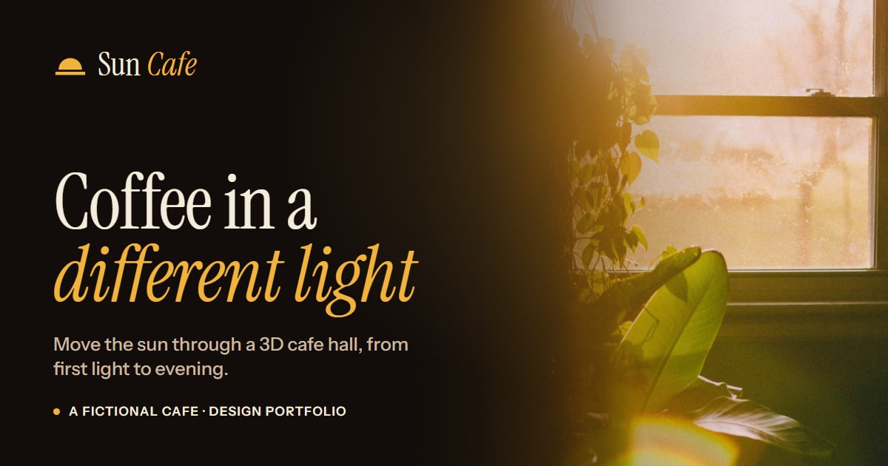

# Sun Cafe — Coffee in a Different Light



A portfolio website for **Sun Cafe**, a cafe that doesn't exist.

The idea behind it: coffee, considered alongside the room you drink it in. Sun Cafe is imagined as one large, open hall with a wall of south-facing windows and two skylights, and the site is built around how daylight moves through that hall from morning to evening. The centrepiece is a **real-time 3D model of the hall** where you can drag the sun through the day and watch light and shadow move across every table and chair.

> **Sun Cafe is fictional.** It's a design and frontend portfolio piece. There's no address, opening hours, real menu or business behind it, and nothing on the site is for sale.

---

## Features

### The daylight studio (`/space`)
- A real-time 3D model of the hall, built with three.js and React Three Fiber, with 67 seats across six zones
- A **time-of-day slider (06:00–20:00)** that moves the sun. Light only enters through the windows and skylights, and every piece of furniture casts its own shadow
- Quick jumps to *First light*, *Morning*, *Midday*, *Golden hour* and *Evening*
- **Play the day**, which animates a full day in under twenty seconds, plus a reset button
- A sun dial showing altitude, bearing and shadow length, and a caption describing the light at the current hour
- A **Show zones** toggle that highlights the six places to sit on the plan
- Deep links: `/space?t=1065` opens the studio at a specific time, in minutes after midnight
- Lower render quality on small or low-powered devices, and a still image when WebGL isn't available

### The rest of the site
- **Home** — a photographic hero, a "live sun" line that uses your local time to say where the sun would be in the hall right now, a walk through the day, signature drinks and a visit band
- **Menu** (`/menu`) — sixteen imagined drinks and bakes, grouped by bar and each paired with the hour of the day it suits best
- **About** (`/about`) — the thinking behind the concept, four brand principles, the bean-to-cup process and the house's unwritten rules
- **Visit** (`/visit`) — a two-question **seat finder** that suggests a part of the hall and links to it in 3D at that hour, plus an honest FAQ
- **Credits** (`/credits`) — every photographer and 3D asset used, with links

### Craft and accessibility
- A deterministic daylight model (`lib/daylight.ts`) that maps time of day to sun direction, light colour and intensity. It runs entirely in the browser with no network calls
- Semantic landmarks, a skip link, visible keyboard focus and labelled controls, including a native range input for the slider
- Respects `prefers-reduced-motion`: reveals are toned down and "Play the day" steps through the hours instead of animating smoothly
- Responsive layouts that are recomposed for mobile, tablet and desktop rather than just scaled down
- Statically exported, so the whole site is plain HTML, CSS and JS that can be hosted anywhere

---

## Tech stack

| | |
|---|---|
| Framework | [Next.js 16](https://nextjs.org) (App Router, static export) + React 19 |
| Language | TypeScript |
| Styling | Tailwind CSS v4 |
| 3D | [three.js](https://threejs.org), [React Three Fiber](https://r3f.docs.pmnd.rs), Drei, postprocessing |
| Animation | [Motion](https://motion.dev) |
| Icons | [Lucide](https://lucide.dev) |
| Fonts | Instrument Sans and Instrument Serif via `next/font` |

---

## Getting started

### Prerequisites
- **Node.js 20.9 or newer** (Next.js 16 requires it)
- **npm** (the repo ships a `package-lock.json`)

### Install and run locally

```bash
# 1. Clone the repository
git clone https://github.com/RonakChavda-Dev/sun-cafe-prototype.git
cd sun-cafe-prototype

# 2. Install dependencies
npm install

# 3. Start the development server
npm run dev
```

Then open [http://localhost:3000](http://localhost:3000).

No environment variables or API keys are needed. Every image, 3D model and texture is stored in `public/`.

### Available scripts

| Command | What it does |
|---|---|
| `npm run dev` | Starts the development server with hot reload |
| `npm run build` | Builds a static export into the `out/` folder |
| `npm run start` | Runs the Next.js production server |
| `npm run lint` | Runs ESLint |

To preview the production build, serve the `out/` folder with any static file server:

```bash
npm run build
npx serve out
```

---

## Deployment

`next.config.ts` sets `output: "export"`, so `npm run build` produces a fully static site in `out/`. You can upload that folder to any static host, such as Cloudflare Pages, Netlify, GitHub Pages or Vercel.

Set the `SITE_URL` environment variable to the deployed address when you build, so link previews (the Open Graph and Twitter card image) point to the right domain:

```bash
SITE_URL=https://your-domain.com npm run build
```

On most hosts you can add `SITE_URL` as a build environment variable in the project settings. If it isn't set, it defaults to `https://sun-cafe-prototype.pages.dev`.

The repo also includes [OpenNext](https://opennext.js.org/cloudflare) and Wrangler scripts (`npm run preview`, `npm run deploy`, `npm run upload`) for deploying to Cloudflare Workers.

---

## Project structure

```text
app/                    Routes (App Router)
  page.tsx              Home
  menu/  space/  about/  visit/  credits/
  layout.tsx            Fonts, metadata, header and footer
  globals.css           Design tokens and global styles
components/
  home/                 Hero, live sun, signature drinks, home sections
  space/                3D cafe scene, daylight studio controls, sun dial
  menu/                 Menu board
  visit/                Seat finder, FAQ
  site-header.tsx       Navigation and mobile menu
  site-footer.tsx
lib/
  daylight.ts           Time of day → sun position, colours and intensities
  cafe-layout.ts        Seats, furniture and zones in the hall
  content.ts            Menu, principles, process and FAQ copy (typed)
  photos.ts             Photo registry with alt text and credits
public/
  images/               Photography
  models/  textures/  env/   3D furniture, materials and HDRI lighting
```

---

## Credits

- **Photography:** free-to-use images from [Unsplash](https://unsplash.com), shown under the Unsplash License. Each photographer is credited on the site's `/credits` page.
- **3D models, textures and HDRI:** [Poly Haven](https://polyhaven.com), CC0.
- **Fonts:** Instrument Sans and Instrument Serif, via Google Fonts.

---

## Disclaimer

Sun Cafe, its menu, its hall and all of its copy are invented for a design portfolio. Any resemblance to a real cafe is unintentional.
